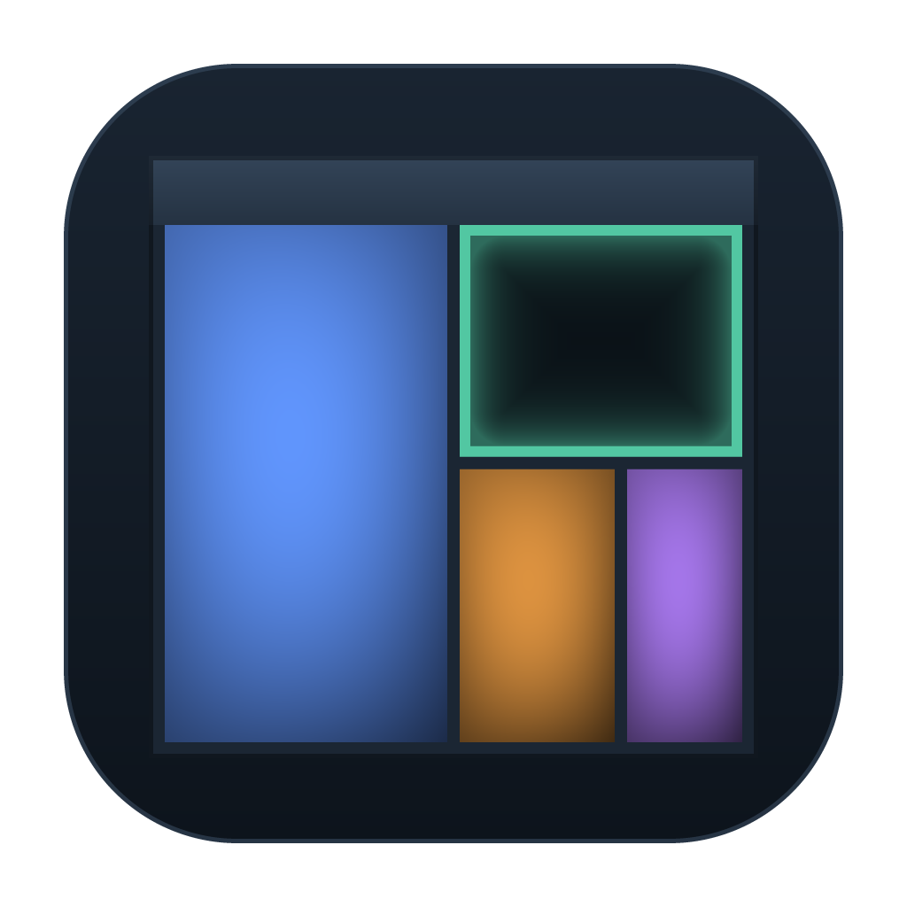
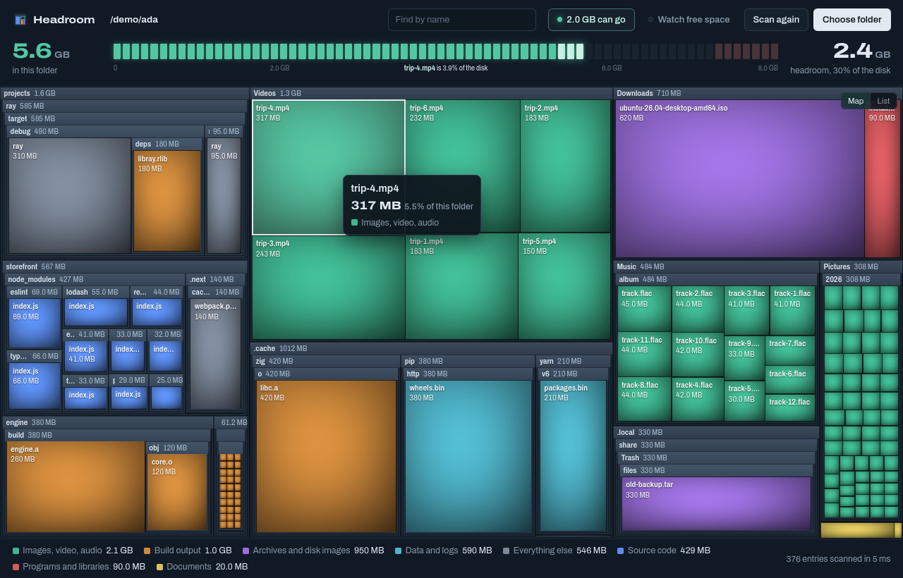
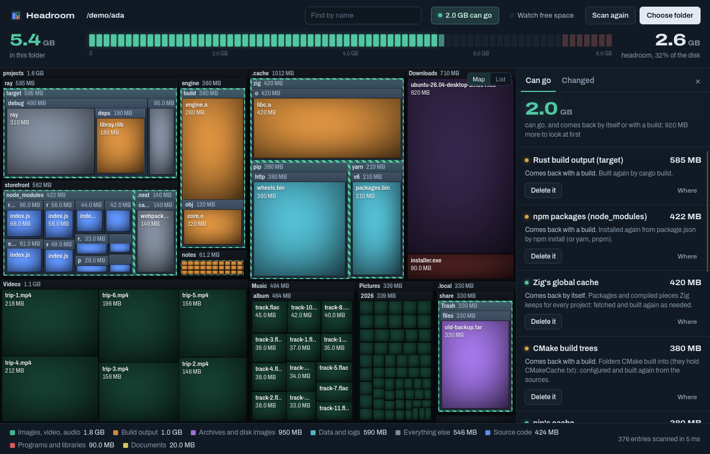
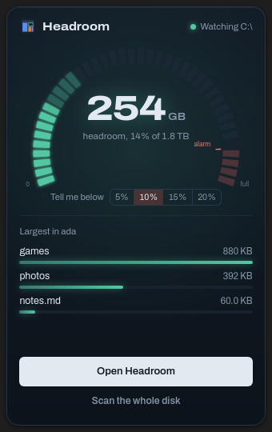

<p align="center">
  
</p>

<h1 align="center">Headroom</h1>

<p align="center">See what fills your disk, and what can go.</p>

<p align="center">
  <a href="https://github.com/dzonerzy/headroom/actions/workflows/ci.yml"></a>
  <a href="https://github.com/dzonerzy/headroom/releases"></a>
  <a href="https://github.com/dzonerzy/plume"></a>
  <a href="https://github.com/dzonerzy/ZeroG"></a>
  
  
  <a href="LICENSE"></a>
</p>



Headroom reads every file in a folder (or a whole disk) and draws them by
the space they take: folders as frames, files as tiles colored by kind. Open
a folder to go deeper; the meter above shows the disk like an audio level
meter, its free space the headroom.

It knows what developers' tools leave behind and make again (`node_modules`,
Rust's `target`, `.zig-cache`, CMake build trees, package managers' caches,
Docker's and WSL's disks), says how safe each is to clear, and clears it.

## What it does

- **Scans fast.** A home folder of 6.5 million files in about ten seconds on
  Windows, the whole disk in fifteen; `/usr` in a third of a second on Linux.
  Sizes are what files take on the disk. Links are not followed, other disks
  mounted inside are not entered, hard links count once on Linux. Run as
  administrator on Windows, it reads the disk's file table (NTFS's MFT) in one
  pass instead: nothing it cannot see, and hard links counted once there too.
- **Draws it all.** A nested treemap drawn by the GPU, every folder that has
  room opened inside its frame; zooms into a folder and back out. Or the same
  folder as a list, for the keyboard and screen readers.
- **Finds by name**, across everything scanned.
- **Knows what can go.** "2.0 GB can go" opens the list of what the rules
  found, biggest first: what each is, whether it comes back by itself, with a
  build, or needs a look first, and its action: delete it, copy the command
  that clears it (`docker system prune`, `npm cache clean --force`), empty the
  Recycle Bin. The map outlines each and dims the rest.
- **Tells what changed.** The next scan of a folder says what grew and shrank
  since the last one, where it happened: `+3.2 GB since 2 Nov`, in
  `projects/engine/build`.
- **Deletes carefully.** To the Recycle Bin (the Trash on Linux) by default,
  after saying what, how big and where; for good only on a second, red
  choice. It will not delete a disk, the system's folders, your home folder or
  the folder scanned, and it warns about what other programs need (virtual
  disks, a repository's `.git`).
- **Sees what you cannot.** After a whole disk, it says how much is in folders
  only an administrator can read, and scans again as one (Windows).
- **Watches free space** from the tray, if you ask: the headroom at a glance,
  and a notification when a disk drops below 5, 10, 15 or 20 percent free.



<p align="center">
  
</p>

## Download

Releases have a Windows installer (and the executable alone, zipped), and for
Linux a `.deb`, a `.tar.gz` and an AppImage. Headroom updates itself from the
releases, checking their signature first.

Windows 10 or 11, or Linux with X11 or Wayland, 64-bit. Nothing else to
install: the web engine it draws with is inside it.

## Privacy

Headroom reads names and sizes, never what is in your files, and keeps what it
measured on your computer (`%LOCALAPPDATA%\Headroom`, or
`~/.local/share/headroom` on Linux). It asks nothing of the network except
GitHub, for updates.

## Building it

Headroom is a [Plume](https://github.com/dzonerzy/plume) application: Zig
for the scanner, the rules and the GPU map, React and Tailwind for the rest,
on the [ZeroG](https://github.com/dzonerzy/ZeroG) engine.

With Zig 0.17, Node.js 22 and the `plume` tool on `PATH`:

```sh
npm install
plume dev        # the app, live on Vite's dev server
plume test       # the tests, headless
plume build      # build/bin/headroom
plume package    # build/package: the installer, the zip, the .deb, ...
```

`zig build scan -Doptimize=ReleaseFast -- <folder>` runs the scanner and the
rules alone on a folder and prints what they found and how long it took.

## License

Headroom's code is under the [BSD 2-Clause license](LICENSE). Its executables
contain the ZeroG engine, whose WebCore and JavaScriptCore are LGPL: each
release carries the engine's `THIRD_PARTY_NOTICES.txt`, and this repository
builds Headroom against any ZeroG engine, a modified one included
([how](https://dzonerzy.github.io/ZeroG/guides/licensing/)).
